# Matomo Analytics Live Counter for Joomla

A lightweight Joomla module that shows live traffic statistics from your self-hosted or cloud **Matomo** server: visitors online, today / yesterday / 7 / 30 days, countries and cities (online and top), top pages, traffic sources, device types and a visits chart.

All data is requested from Matomo in **one bulk API call** and cached with the Joomla Cache API, so your Matomo server and your page speed stay unaffected.

---

## Features


### Live numbers

* Visitors online (last 5–60 minutes), today, pages today, yesterday, 7 and 30 days.
* Rows with zero visits are never shown in any list.

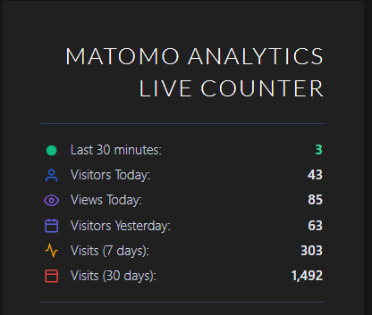

### Geography

* Countries online, cities online, top countries and top cities (today / yesterday / 7 / 30 days) with percentage bars.
* Flags are served by **your own Matomo server**, no third-party requests.

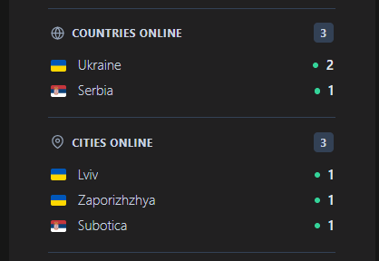
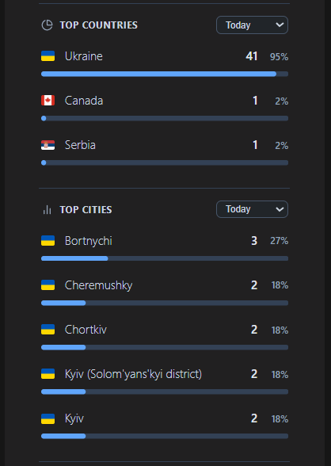

### Content and audience (off by default)

* Top pages (by page title, with site-name cleanup), traffic sources and device types.

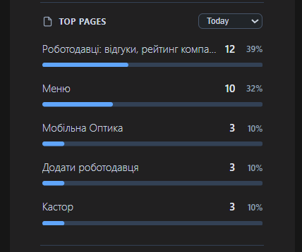
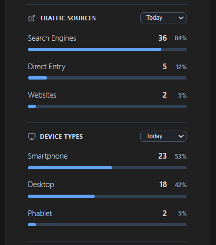

### Visits chart

* Native SVG, 7 or 30 days: a line with peak and average, or bars.
* Visitors switch the style with an icon next to the period selector; the choice is remembered in their browser.
* Optional % change against the previous period.

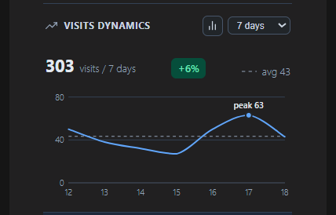

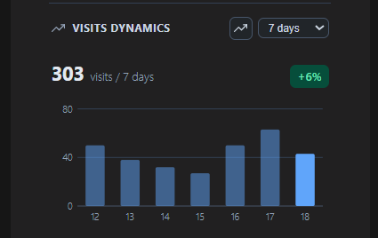

### Light and dark theme

* Automatic (follows `data-bs-theme`), or forced in the settings.


### Administrator tools

* Readable error messages and warnings above the module; visitors never see errors.
* Debug block: cache status, API weight per method, durations, PHP and Matomo versions.
* "Refresh now" button that asks Matomo immediately.

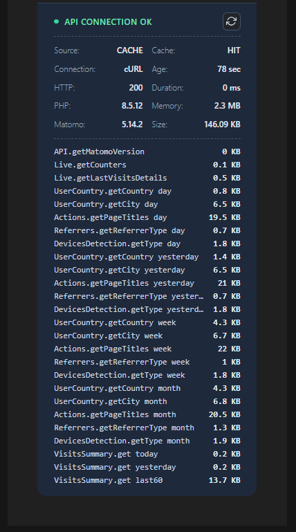

### And also

* **Per-block visibility:** every block can be shown, hidden or shown to administrators only.
* **Robust:** if Matomo is down, the last cached data is shown; one request to Matomo at a time; short timeout.
* **Multilingual:** English, Russian, Ukrainian; the language can be forced.
* **Safe frontend:** no inline styles or scripts (works with a strict Content-Security-Policy); several module instances on one page are supported.

---

## Requirements

* Joomla 4.x / 5.x / 6.x
* PHP 8.1+ with the `cURL` extension (`intl` is optional)
* Matomo (self-hosted or cloud) with API access
* For cities: a GeoIP database with city data in Matomo

---

## Installation

1. Download the module zip.
2. **System → Install → Extensions** and upload it. Updating over an older version keeps your settings and clears the module cache.
3. **Content → Site Modules**, open **Matomo Analytics Live Counter**.
4. Fill in **Matomo Installation URL**, **Site ID** and **Token Auth**.
5. Choose the blocks on the **Metrics Display** tab.
6. Select a position and a **Menu Assignment** (for example *On all pages*) and publish.

Updates are delivered through the Joomla update server defined in the manifest.

---

## Configuration

### Connection (Module tab)

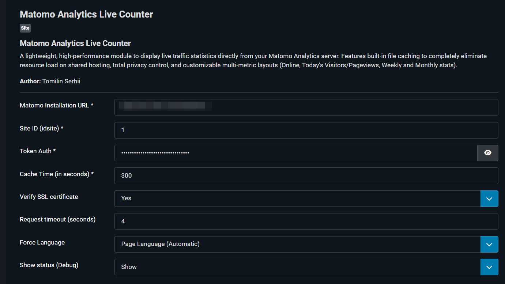

| Setting | Default | Description |
|---|---|---|
| Matomo Installation URL | – | Address of the folder with Matomo's `index.php`, `http(s)://` required |
| Site ID (idsite) | 1 | Site number in Matomo |
| Token Auth | – | Matomo API token |
| Cache Time (in seconds) | 300 | How long the data is considered fresh (min. 10) |
| Verify SSL certificate | Yes | Turn off only for a self-signed certificate |
| Request timeout (seconds) | 4 | How long the site waits for Matomo (1–15) |
| Force Language | Page Language | Follow the page language or force uk-UA / ru-RU / en-GB |
| Show status (Debug) | Administrators Only | Who sees the debug block |

### Metrics Display

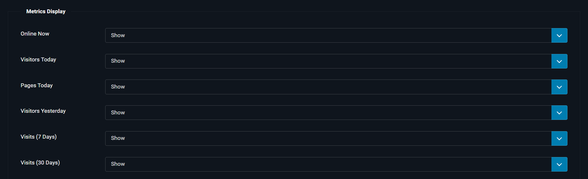

Each block: **Show / Hide / Administrators Only**.

Online Now · Visitors Today · Pages Today · Visitors Yesterday · Visits (7 Days) · Visits (30 Days) · Countries Online · Top Countries · Cities Online · Top Cities · Top Pages\* · Traffic Sources\* · Device Types\* · Visits Chart  (\* hidden by default)

| Setting | Description |
|---|---|
| Remove from page titles | Texts (one per line) cut off the **start or end** of page titles, e.g. the site name. Case-insensitive; the neighbouring separator is removed. The middle of a title is never changed |
| Default chart style | Line with peak and average, or bars. Visitors can switch |

### Data and Display

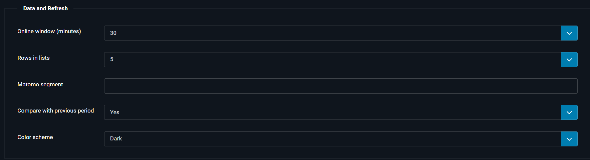

| Setting | Default | Description |
|---|---|---|
| Online window (minutes) | 30 | Visitors active within this time are "online" (5 / 10 / 15 / 30 / 60) |
| Rows in lists | 5 | Rows in online and top lists (3 / 5 / 7 / 10) |
| Matomo segment | – | Filters all numbers, e.g. `countryCode==ua` or `pageUrl=@/ru/` |
| Compare with previous period | No | Shows % change next to the chart total; uses one 60-day request instead of two |
| Color scheme | Auto | Auto / Light / Dark |

---

## On the Matomo side

* **Token:** create a dedicated Matomo user with *View* access to this site only, and a token for it with **Only allow secure requests (POST)** enabled. The module sends the token in a POST body.
* **Archiving:** day, 7-day and 30-day reports follow Matomo's own archiving schedule (cron or browser-triggered). A very short *Cache Time* cannot make them fresher than Matomo itself. Online data comes from the live visitor log and is real-time.
* **Cities:** need a GeoIP database with cities (**System → Geolocation**). City names are provided by Matomo in English only.
* **Segments:** the online block works with any segment immediately. For the other blocks, when browser archiving is disabled, the segment must be saved in Matomo as a pre-processed segment; use its exact definition. Matomo errors are shown to administrators above the module.

---

## How it works

```
Visitor ──> Joomla page ──> cache entry fresh? ──yes──> render HTML
                                   │ no
                                   ▼
                    one request at a time (file lock)
                                   │
                 API.getBulkRequest (POST, cURL) ──> Matomo
                                   │
          success: store in Joomla cache     error: serve last cached data,
                                             retry in 60 s
```

**Matomo API methods** (all in one bulk request, only for visible blocks):

| Block | Method |
|---|---|
| Online Now | `Live.getCounters` |
| Countries / Cities Online | `Live.getLastVisitsDetails` (limit 500, only visits inside the online window) |
| Top Countries / Top Cities | `UserCountry.getCountry` / `UserCountry.getCity` |
| Visitors, Pages Today, Yesterday | `VisitsSummary.get` |
| Visits (7 / 30 days), chart | `VisitsSummary.get` (`last7`, `last30`, or `last60` when comparing) |
| Top Pages | `Actions.getPageTitles` (`flat=1`) |
| Traffic Sources | `Referrers.getReferrerType` |
| Device Types | `DevicesDetection.getType` |
| Version (debug) | `API.getMatomoVersion` |

Top lists use the periods *today*, *yesterday*, `last7` and `last30`.

**Cache:** Joomla Cache API, group `mod_matomo_counter` (cleared by *System → Clear Cache*). One entry per combination of URL, site, language, segment, visible blocks and list settings. Data is kept for 24 hours so it can be shown when Matomo is unavailable.

**Failures:** if Matomo does not answer, visitors see the last cached data (or nothing if there is none); administrators see the reason. Only one timeout is spent per page view.

**Frontend assets:** `media/mod_matomo_counter/css/counter.css` and `js/counter.js`, loaded through the Joomla WebAssetManager. The script only handles the period selectors, the chart style switch and the administrator's refresh button.

**Refresh now:** the button in the debug block calls `com_ajax` and works for administrators only; repeated clicks within 5 seconds are ignored.

### Package structure

```
mod_matomo_counter.php      module entry point
mod_matomo_counter.xml      manifest and settings
helper.php                  com_ajax endpoint (administrators)
script.php                  installer script
src/Helper/                 MatomoCounterHelper (API, cache, lock),
                            ModuleRenderer, Translator
tmpl/default.php            layout (Joomla template overrides supported)
media/                      css, js, joomla.asset.json
language/                   en-GB, ru-RU, uk-UA
```

---

## Security and privacy

* The token is stored in the module parameters and sent only in POST requests; SSL certificates are verified by default.
* The `com_ajax` endpoint answers administrators only.
* The module shows aggregated numbers only and stores nothing about visitors. On low-traffic sites a single city or country in the *online* lists can identify a visitor: consider *Administrators Only* for **Cities Online**.

---

## Troubleshooting

| Symptom | Likely cause |
|---|---|
| Module not visible | Not published, no Menu Assignment, or URL / Token not set (administrators see a hint) |
| "Cannot connect to Matomo" | Wrong URL (it must open the folder with `index.php`), firewall, or SSL problem |
| "Matomo API error" | Wrong Token Auth or Site ID, or the user has no *View* access |
| Cities are empty | No GeoIP city database in Matomo |
| Numbers lag behind Matomo | *Cache Time* and Matomo's archiving schedule |
| Warning about a segment | The segment is not pre-processed in Matomo |

Switch **Show status (Debug)** on to see cache status, API weights per method, durations and versions.

---

## Languages

English (en-GB), Russian (ru-RU), Ukrainian (uk-UA). The module reads its own `language/<tag>/mod_matomo_counter.ini` files, so a forced language works regardless of the page language. To add a language, add a folder with a translated `.ini` file; missing keys fall back to English.

---

## License

GNU General Public License v2 or later. See `LICENSE.txt`.

